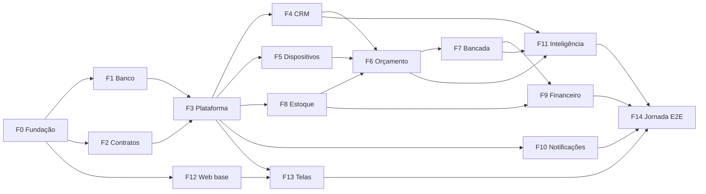

# ebisuCRM — Spec do MVP (entrada para planejamento e orquestração)

> Versão 1.0 · 2026-10-27 · Status: **aprovado para planejamento**
>
> Este documento é a **entrada única** para quebrar o MVP em tarefas e distribuí-las entre agentes.
> Ele não repete detalhes: aponta para as fontes de verdade e define o que cada frente entrega,
> os contratos entre frentes e quando algo está pronto.

## 0. Fontes de verdade

| Assunto | Arquivo | Regra de precedência |
|---|---|---|
| Modelo de dados | [`schema.prisma`](../packages/db/prisma/schema.prisma) | Fonte única de tabelas, colunas e relações |
| Constraints, RLS, triggers, papéis de banco | [migração inicial](../packages/db/prisma/migrations/20261027000000_inicial/migration.sql) (seções 1–5, depois do SQL gerado pelo Prisma) | Toda constraint nova entra em migração nova (§5.8) |
| Regras de negócio, estados, comandos | [`invariantes.md`](./invariantes.md) | IDs (`EST-6`, `OS-3`…) são citados em tarefas, testes e PRs |
| Testes das regras do banco | [`sql/testes-invariantes.sh`](./sql/testes-invariantes.sh) | Devem passar no CI |
| Escopo e motivos | [`consolidacao-revisoes.md`](./consolidacao-revisoes.md) | Histórico das decisões |
| Contexto de produto (v0.1) | [`README.md`](./README.md) | Referência; onde divergir, vale este spec |

Em caso de conflito: **este spec > invariantes.md > schema.prisma > consolidação > README**.
Divergência encontrada durante a execução vira pergunta ao dono do produto, não decisão local.

---

## 1. Objetivo do MVP

Uma assistência técnica consegue, **de ponta a ponta e sem inconsistência**:

1. Captar leads (site, WhatsApp, balcão, CSV, API) e trabalhá-los num funil com "o que falta",
   temperatura, quadrante e fila de próximas ações.
2. Orçar, enviar por link, receber aprovação (total ou parcial) e converter em OS.
3. Operar a bancada: OS com ou sem orçamento, inspeção de entrada/saída, peças, técnico, garantia,
   entrega e prontuário do dispositivo.
4. Controlar estoque (comprei / usei / ajustei / devolvi) com custo médio, e o financeiro gerencial
   (a receber por OS, a pagar por compra, pagamentos, margem).
5. Avisar o cliente por WhatsApp, e-mail ou SMS conforme a preferência dele.

Tudo multi-tenant, multi-empresa e com RBAC.

**Fora do MVP** (não planejar): editor de papéis, múltiplos funis, tags, scoring/próxima ação
configuráveis, catálogo de modelos e compatibilidade, reservas de estoque, venda de balcão, caixa
diário, múltiplos depósitos, lote/serial de peças, fiscal (NF-e/NFS-e), ERPNext, inbox WhatsApp,
SSO/2FA, webhooks de saída, campos customizados, app mobile nativo.

---

## 2. Decisões

### 2.1 Produto

| ID | Decisão |
|---|---|
| D-P01 | Lead e cliente são a mesma entidade (`contato`); `ciclo_vida` é derivado (CRM-2) |
| D-P02 | Conversão = orçamento aprovado → OS. 1 orçamento gera no máximo 1 OS; aprovação parcial leva só os itens aprovados |
| D-P03 | OS pode nascer direto na bancada, sem orçamento |
| D-P04 | O cliente remove o bloqueio ao entregar o aparelho; o sistema não guarda senha, PIN, padrão ou biometria |
| D-P05 | Termo de responsabilidade aceito na inspeção de entrada |
| D-P06 | Clientes e estoque não são compartilhados entre empresas (escopo por CNPJ) |
| D-P07 | Estoque negativo proibido; peça sem saldo vira `A_COMPRAR` |
| D-P08 | Custo médio ponderado móvel por empresa; financeiro é gerencial (não fiscal) |
| D-P09 | Receita gerencial reconhecida na entrega da OS; sinal é pagamento no título da OS |
| D-P10 | Lead excluído que volta é restaurado e mesclado (salvo se anonimizado) |
| D-P11 | Exclusão LGPD = anonimização; ledgers preservados |
| D-P12 | Temperatura, quadrante, completude e próxima ação por regras fixas no código, com explicação |
| D-P13 | Interface em pt-BR, moeda BRL, fuso por empresa (padrão America/Sao_Paulo) |

### 2.2 Arquitetura

| ID | Decisão |
|---|---|
| D-A01 | Monolito modular (um processo de API + um processo de worker), não microsserviços |
| D-A02 | Front e back separados por API REST `/v1` documentada em OpenAPI |
| D-A03 | Toda mudança de estado passa por um **comando de domínio** transacional; controllers não acessam o Prisma diretamente |
| D-A04 | Isolamento em 3 camadas: RLS (tenant), FKs compostas (empresa), checagem de escopo na aplicação (membro) |
| D-A05 | Contexto de tenant via `set_config('app.tenant_id', $1, true)` no início de cada transação; papel de banco sem `BYPASSRLS` |
| D-A06 | Outbox para notificações (gravada na transação do comando); envio por worker |
| D-A07 | Idempotência por `Idempotency-Key` em todo POST que cria ou muda estado |
| D-A08 | Trava otimista por `versao_registro` nas entidades editáveis concorrentemente |
| D-A09 | Ledgers e históricos append-only; correção por estorno |
| D-A10 | Schemas Zod compartilhados entre front e back (`packages/contracts`); OpenAPI gerado a partir deles |
| D-A11 | Arquivos em storage S3-compatível com URL pré-assinada; a API nunca trafega o binário |

### 2.3 Tecnologia

| ID | Escolha |
|---|---|
| D-T01 | Node.js 24 LTS (obrigatório: a API em CommonJS importa pacotes ESM via `require(esm)`), TypeScript 5.9 `strict`, pnpm workspaces + Turborepo |
| D-T02 | API: NestJS 11; validação com Zod (pipe próprio); OpenAPI via `@asteasolutions/zod-to-openapi` |
| D-T03 | Banco: PostgreSQL 16 + Prisma 6; migrações versionadas (`prisma migrate`) com SQL complementar anexado |
| D-T04 | Filas: Redis 7 + BullMQ |
| D-T05 | Auth: senha com argon2id; access token JWT de 15 min; refresh token rotativo em cookie httpOnly (web); API key no header `X-Api-Key` |
| D-T06 | Web: React 19 + Vite + TanStack Router + TanStack Query + shadcn/ui + Tailwind; formulários com React Hook Form + Zod |
| D-T07 | Testes: Vitest (unidade), Testcontainers + Supertest (integração), Playwright (E2E) |
| D-T08 | Dev local: Docker Compose com Postgres, Redis, SeaweedFS (S3; substitui o MinIO, que deixou de publicar imagens) e Mailpit. Cliente S3 (AWS SDK v3) com `requestChecksumCalculation: 'WHEN_REQUIRED'`, senão a URL pré-assinada de upload embute checksum do corpo vazio e o PUT falha com `BadDigest` |
| D-T09 | Observabilidade: logs Pino em JSON com `request_id`, OpenTelemetry, Sentry |
| D-T10 | Qualidade: ESLint (flat config) + Prettier; Conventional Commits; CI no GitHub Actions |
| D-T11 | Provedores (adapters plugáveis): WhatsApp Cloud API (Meta), SMS Zenvia, e-mail Resend; em dev/test, adapters falsos |

---

## 3. Arquitetura alvo

### 3.1 Estrutura do repositório

```
ebisu-crm/
├─ apps/
│  ├─ api/                 # NestJS: HTTP + comandos de domínio
│  │  └─ src/
│  │     ├─ core/          # tx/tenancy, auth, rbac, idempotência, erros, audit, eventos, sequências
│  │     ├─ modules/
│  │     │  ├─ plataforma/ # tenants, empresas, membros, papéis, api keys
│  │     │  ├─ crm/        # contatos, captura, funil, negócios, atividades, tarefas, lotes
│  │     │  ├─ dispositivos/ # dispositivos, prontuário, acessórios, checklists, inspeções
│  │     │  ├─ orcamentos/
│  │     │  ├─ bancada/    # ordens de serviço
│  │     │  ├─ estoque/    # itens, fornecedores, compras, movimentos
│  │     │  ├─ financeiro/ # títulos, pagamentos
│  │     │  ├─ notificacoes/
│  │     │  ├─ inteligencia/ # scoring, próximas ações
│  │     │  ├─ relatorios/
│  │     │  └─ anexos/
│  │     └─ main.ts
│  ├─ worker/              # BullMQ: notificações, scoring, lotes, jobs agendados
│  └─ web/                 # React
├─ packages/
│  ├─ contracts/           # Zod + tipos + OpenAPI (um diretório por domínio)
│  ├─ db/                  # schema.prisma, migrações, seeds, cliente com extensão de tenancy
│  ├─ domain-rules/        # regras puras: scoring, próximas ações, máquinas de estado, custo médio
│  └─ ui/                  # componentes compartilhados (shadcn)
├─ docs/
└─ docker-compose.yml
```

### 3.2 Regras de dependência

- `apps/*` podem depender de `packages/*`; `packages/*` nunca dependem de `apps/*`.
- `packages/domain-rules` é TypeScript puro (sem Prisma, sem Nest): fácil de testar.
- Um módulo da API não importa repositórios de outro módulo: usa o **serviço público** do outro
  módulo ou reage a **eventos de domínio** (§5.5).
- Só `core/tx` abre transações; comandos recebem um `TxContext` (§5.4).

### 3.3 Arquivos compartilhados e dono (evita conflito entre agentes)

| Arquivo / área | Dono | Outras frentes |
|---|---|---|
| `packages/db/prisma/schema.prisma` e migrações | F1 | Pedem mudança por issue/PR para F1 |
| `packages/contracts/src/comum/**` (paginação, erros, ids) | F2 | Só leitura |
| `packages/contracts/src/<dominio>/**` | Frente do domínio | — |
| Catálogo de permissões (`core/rbac/permissoes.ts`) e seed de papéis | F3 | Acrescentam chaves só no bloco do seu domínio |
| Catálogo de eventos (`core/eventos/catalogo.ts`) | F2 | Frentes propõem eventos novos via PR para F2 |
| Registro de módulos (`app.module.ts`) | F0 | Uma linha por módulo |
| Rotas e layout do web (`apps/web/src/routes/__root*`) | F12 | Rotas de domínio em pasta própria |

---

## 4. Frentes de trabalho

Cada frente tem escopo, dependências, caminhos de código e definição de pronto própria (além do
DoD global da §6.1). As invariantes citadas devem ter teste.

### Visão de dependências e ondas



| Onda | Frentes (em paralelo) | Começa quando |
|---|---|---|
| 0 | F0 | — |
| 1 | F1, F2, F12 | F0 pronta |
| 2 | F3 | F1 e F2 prontas |
| 3 | F4, F5, F8, F10 (infra) + telas correspondentes (F13) | F3 pronta |
| 4 | F6 + telas | F4, F5, F8 prontas |
| 5 | F7 + telas | F6 pronta |
| 6 | F9, F11, F10 (ligação aos eventos) + telas | F7 pronta (F9 pode iniciar compras/títulos após F8) |
| 7 | F14 | Todas as anteriores |

---

### F0 — Fundação do monorepo e CI

- **Escopo:** pnpm + Turborepo; tsconfig base `strict`; ESLint/Prettier; esqueleto de `apps/api`,
  `apps/worker`, `apps/web` e `packages/*`; Docker Compose (Postgres 16, Redis 7, SeaweedFS, Mailpit);
  `.env.example`; CI com jobs `lint`, `typecheck`, `test`, `build`, `db-invariantes`; Conventional Commits.
- **Depende de:** nada.
- **Pronto quando:** `pnpm i && pnpm dev` sobe API (`GET /v1/saude` → 200), worker e web; o CI roda
  verde num PR vazio; `docker compose up` sobe toda a infraestrutura local.

### F1 — Banco, migrações e cliente com tenancy

- **Escopo:** mover `docs/schema.prisma` para `packages/db`; migração inicial = SQL do Prisma +
  `complemento-v0.2.sql`; papéis de banco `ebisu_app` (sem BYPASSRLS) e `ebisu_auth`;
  extensão do Prisma Client que executa `set_config('app.tenant_id', …, true)` em toda transação
  (padrão de transação em lote); helper `comTenant(ctx, fn)`; seeds (permissões, papéis padrão, funil
  padrão com etapas e requisitos, checklists padrão de celular e notebook, tipos de acessório,
  modelos de mensagem, motivos de perda); seed de demonstração.
- **Depende de:** F0.
- **Invariantes:** SEG-1, SEG-2, SEG-6 e todas as marcadas **Banco** em `invariantes.md`.
- **Pronto quando:** `prisma migrate deploy` num banco vazio aplica tudo; `testes-invariantes.sh`
  passa no CI (35/35); teste de integração prova que uma consulta sem contexto retorna 0 linhas e
  que o contexto não vaza entre transações no mesmo pool; seeds idempotentes.

### F2 — Contratos compartilhados

- **Escopo:** `packages/contracts` com: tipos comuns (UUID, dinheiro em string decimal, datas ISO),
  paginação por cursor, filtros, envelope de erro RFC 9457 com catálogo de códigos (§5.2), schemas
  Zod por domínio (esqueletos), geração de OpenAPI em `apps/api/openapi.json`, catálogo de eventos
  de domínio (§5.5), interfaces de providers (§5.6). Pipe de validação Zod no Nest.
- **Depende de:** F0.
- **Pronto quando:** o build gera o OpenAPI sem erro; um endpoint de exemplo valida entrada e saída
  pelo schema; front importa tipos do pacote; testes do envelope de erro e da paginação.

### F3 — Plataforma: auth, tenancy, RBAC, idempotência, auditoria

- **Escopo:** cadastro de tenant + empresa inicial + owner; login, refresh rotativo com detecção de
  reuso, logout; convite de membros; papéis padrão e atribuição por empresa; guard que resolve
  `TxContext` (tenant, empresa via `X-Empresa-Id`, membro, permissões); decorator
  `@Permissao('recurso.acao')` com escopo PROPRIO/EMPRESA/TENANT; API keys com escopos e CORS por
  origem; interceptor de idempotência (`idempotencia_requisicao`); audit log automático nos comandos;
  serviço de sequência de documentos; CRUD de empresas e membros; endpoint `GET /v1/eu`.
- **Depende de:** F1, F2.
- **Invariantes:** SEG-1 a SEG-8.
- **Pronto quando:** suíte de isolamento passa: membro da empresa A não lê, altera, exclui nem
  referencia dados da empresa B, nem um tenant os de outro, por id, filtro, lote ou job; repetir um
  POST com a mesma `Idempotency-Key` devolve a mesma resposta e não duplica efeitos; reuso de refresh
  token invalida a família; custos somem da resposta sem `financeiro.ver_custos`.

### F4 — CRM

- **Escopo:** CRUD de contatos (com dedupe CRM-1 e normalização E.164/e-mail), consentimentos,
  origens, motivos de perda, funil (editar nomes/ordem/requisitos), negócios
  (`MoverNegocio`, `PerderNegocio`, nutrição), atividades, tarefas; `CapturarLead` (API key e
  endpoint público); APIs em massa (criar/atualizar/excluir até 500 síncrono, 207 por linha; acima
  → `job_lote`); importação CSV; `AnonimizarContato`; cálculo de completude e `campos_faltantes` a
  partir dos requisitos.
- **Depende de:** F3.
- **Invariantes:** CRM-1 a CRM-5, LOT-1 a LOT-4.
- **Pronto quando:** capturar o mesmo lead duas vezes (mesmo e-mail ou telefone) gera 1 contato e
  2 capturas; lead excluído e recapturado é restaurado; negócio não avança sem requisitos
  obrigatórios; lote de 1.000 linhas com 10 inválidas termina `CONCLUIDO_COM_ERROS` com as 10 linhas
  identificadas e é seguro reprocessar; anonimização remove dados pessoais e preserva ids.

### F5 — Dispositivos, prontuário e inspeções

- **Escopo:** CRUD de dispositivos com `especificacoes` validadas por tipo (Zod), busca por IMEI e
  serial, troca de proprietário (DSP-2), prontuário (leitura + observação manual), tipos de
  acessório, modelos de checklist, inspeções de entrada/saída com snapshot, política de bloqueio
  (DSP-5) e termo de responsabilidade; serviço público `registrarEventoDispositivo` usado por F6/F7/F8.
- **Depende de:** F3.
- **Invariantes:** DSP-1 a DSP-7, ANX-1 (com o módulo de anexos: upload por URL pré-assinada).
- **Pronto quando:** inspeção de entrada sem bloqueio removido nem justificativa é recusada;
  checklist alterado depois não muda inspeções antigas; troca de dono encerra o vínculo anterior e
  aparece no prontuário; anexos sobem e descem por URL pré-assinada.

### F6 — Orçamento

- **Escopo:** criar/editar rascunho e itens (com custo snapshot), `EnviarOrcamento`,
  `RevisarOrcamento`, link público (visualizar → `VISUALIZADO`, aprovar total/parcial, reprovar)
  com evidência, `DecidirOrcamento` + `ConverterOrcamento` atômicos, job de expiração, lembrete
  `ORCAMENTO_EXPIRANDO`, PDF/visualização para o cliente.
- **Depende de:** F4, F5, F8 (itens do catálogo).
- **Invariantes:** ORC-1 a ORC-6, OS-1.
- **Pronto quando:** orçamento enviado não aceita mudança de itens/valores; revisão cria versão nova
  e invalida o link antigo; duas aprovações simultâneas geram 1 OS; aprovação parcial gera OS só
  com os itens aprovados; negócio vai a GANHO e contato a CLIENTE na mesma transação.

### F7 — Bancada (OS)

- **Escopo:** `AbrirOS` (com ou sem orçamento), `MudarStatusOS` com a tabela de transições,
  atribuição de técnico, itens e peças (`AplicarPeca`, devolução), notas técnicas com tempo,
  acessórios, retorno em garantia, `EntregarOS`, cancelamento/sem reparo (OS-8), visão Kanban
  (endpoint agregado por status com filtros), prazo e prioridade.
- **Depende de:** F6 (e F5, F8).
- **Invariantes:** OS-1 a OS-8, EST-6 (via F8), DSP-7.
- **Pronto quando:** toda transição fora da tabela é recusada com `transicao_invalida`; duas edições
  simultâneas → uma recebe 409 `conflito_versao`; duas OS aplicando a última peça → uma recebe 409
  `estoque_insuficiente` e o item vira `A_COMPRAR`; entrega exige inspeção de saída e acessórios
  devolvidos; cancelar OS com peça aplicada devolve ao estoque.

### F8 — Estoque e compras

- **Escopo:** CRUD de itens (produto/serviço) e fornecedores; compras (rascunho → `ReceberCompra`
  com rateio de frete; cancelamento com estorno); `AjustarEstoque`; `EstornarMovimento`; serviço
  público `baixarEstoque` / `devolverEstoque` usado por F7 (padrão SQL de EST-6); histórico por item
  (ledger); alerta de estoque mínimo; job de reconciliação (EST-8); importação CSV de itens.
- **Depende de:** F3.
- **Invariantes:** EST-1 a EST-8.
- **Pronto quando:** custo médio confere com cálculo manual em sequência de entradas e saídas
  (teste com tabela de casos); concorrência na última unidade resolvida sem saldo negativo;
  receber a mesma compra duas vezes não duplica entrada; reconciliação detecta divergência
  provocada artificialmente.

### F9 — Financeiro gerencial

- **Escopo:** títulos a receber (um por OS, criado por F7) e a pagar (por compra, com parcelas);
  `RegistrarPagamento` (lock do título), `EstornarPagamento`; listagens de contas a pagar/receber
  com vencidos; margem por OS; resumo do período (receita gerencial, custo, taxas).
- **Depende de:** F7, F8.
- **Invariantes:** FIN-1 a FIN-6.
- **Pronto quando:** pagamentos concorrentes no mesmo título não ultrapassam o valor; estorno
  recalcula status; margem da OS = total − custo das peças − taxas, conferida em teste.

### F10 — Notificações

- **Escopo:** infraestrutura (onda 3): outbox, worker com `FOR UPDATE SKIP LOCKED`, retry com
  backoff, fallback de canal, renderização Handlebars, adapters (WhatsApp Cloud, Zenvia, Resend e
  falsos), webhooks de status, regra de janela de 24h do WhatsApp, respeito a consentimento.
  Ligação aos eventos (onda 6): handlers que criam notificações a partir dos eventos de F6/F7.
  CRUD de modelos de mensagem.
- **Depende de:** F3 (infra); F6, F7 (ligação).
- **Invariantes:** NOT-1 a NOT-6.
- **Pronto quando:** derrubar o worker no meio do envio não perde nem duplica mensagens; webhook
  repetido não regride status; contato sem consentimento transacional no canal cai no próximo canal
  permitido; mensagens aparecem no Mailpit/adapters falsos nos testes E2E.

### F11 — Inteligência e relatórios

- **Escopo:** `packages/domain-rules/scoring` (fit, engajamento com meia-vida, temperatura,
  quadrante, motivos) e `proximas-acoes` (regras da §3.3 do README); recálculo síncrono após
  comandos relevantes + job diário; endpoint da fila de próximas ações (aceitar → tarefa; lembrar
  depois); `ciclo_vida` derivado (CRM-2); relatórios: funil, origens/UTM, quadrantes, parados (SLA),
  aprovação de orçamento, motivos de perda, TAT da bancada por status/técnico, receita e margem,
  estoque abaixo do mínimo.
- **Depende de:** F4, F6, F7 (F9 para relatórios financeiros).
- **Invariantes:** CRM-2, CRM-6.
- **Pronto quando:** cada score é reproduzível a partir de `score_motivos` e da versão das regras;
  testes de tabela cobrem as regras de scoring e de próximas ações; relatórios batem com consultas
  de referência sobre o seed de demonstração.

### F12 — Web base

- **Escopo:** app React com roteamento, layout (menu por módulo, seletor de empresa), login e
  refresh, cliente HTTP tipado a partir de `packages/contracts` (com `Idempotency-Key` automática
  em POST e tratamento de 409/422), tabela com paginação por cursor e filtros, formulários com Zod,
  componentes base (`packages/ui`), estados vazios/erro/carregando, responsivo (técnico no celular).
- **Depende de:** F0 (F2 para tipos).
- **Pronto quando:** login → seletor de empresa → página protegida funciona contra a API; permissões
  escondem menus e ações; Lighthouse acessibilidade ≥ 90 nas páginas base.

### F13 — Telas por domínio

Uma subfrente por domínio, iniciada junto com a frente de API correspondente (consome o contrato,
usa mocks gerados do schema até a API ficar pronta):

| Subfrente | Telas |
|---|---|
| F13-CRM | Dashboard (últimos leads, funil, quadrantes, fila de próximas ações), lista e ficha do contato (com "o que falta" e motivos do score), quadro de negócios por etapa, importação CSV |
| F13-DSP | Dispositivo e prontuário, inspeção (checklist, bloqueio, termo, fotos) |
| F13-ORC | Editor de orçamento, página pública de aprovação (sem login, mobile-first) |
| F13-OS | Kanban da bancada, detalhe da OS (timeline, peças, notas, entrega) |
| F13-EST | Itens, fornecedores, compras, ajuste, histórico do item |
| F13-FIN | Contas a receber/pagar, registrar pagamento, resumo do período |
| F13-CFG | Empresa, membros e papéis, funil e requisitos, modelos de mensagem, API keys |

- **Pronto quando (cada subfrente):** fluxos do domínio executáveis só pela UI; erros de regra
  (409/422) exibidos com mensagem do catálogo; teste Playwright do caminho feliz.

### F14 — Jornada E2E e endurecimento

- **Escopo:** cenários E2E da §6.3, teste de carga básico, revisão de segurança (OWASP ASVS nível 1
  nos pontos de auth, RLS, uploads e link público), backup/restore documentado, seed de demonstração,
  guia de implantação.
- **Depende de:** todas.
- **Pronto quando:** DoD do MVP (§6.3) atendido.

---

## 5. Contratos

### 5.1 Convenções HTTP

| Tema | Contrato |
|---|---|
| Base | `/v1`; JSON UTF-8; campos `snake_case` (iguais ao banco) |
| Auth (web) | `Authorization: Bearer <access_token>`; refresh em cookie httpOnly `SameSite=Strict` via `POST /v1/auth/refresh` |
| Auth (integração) | `X-Api-Key: ebk_live_…`; só endpoints cujo escopo a chave possui |
| Empresa | `X-Empresa-Id: <uuid>` obrigatório em rotas de domínio; validado contra as atribuições do membro |
| Idempotência | `Idempotency-Key` (UUID) obrigatório em POST de criação/comando; mesma chave + mesmo corpo → mesma resposta; corpo diferente → 422 `idempotencia_divergente`; em processamento → 409 `idempotencia_em_andamento`; validade 24 h |
| Concorrência | PATCH e comandos sobre entidades com `versao_registro` exigem o campo no corpo; divergência → 409 `conflito_versao` |
| Paginação | `?limit=` (padrão 25, máx. 100) e `?cursor=`; resposta `{ "dados": [...], "proximo_cursor": "…" \| null }` |
| Filtros | `?filtro[campo]=valor`, `?filtro[campo][gte]=…`; busca textual `?q=` onde indicado |
| Ordenação | `?ordem=-created_at,nome` |
| Datas | ISO 8601 com fuso (`2026-10-27T14:00:00-03:00`); `Date` como `YYYY-MM-DD` |
| Dinheiro | string decimal com 2 casas (`"123.40"`); quantidade com até 3 casas |
| Exclusão | `DELETE` faz soft delete onde há `deleted_at`; responde 204 |
| Comandos | `POST /v1/<recurso>/{id}/<verbo>` (ex.: `/orcamentos/{id}/enviar`) |
| Lote | 207 com `{ "resultados": [{ "indice", "status", "id"?, "erro"? }] }`; > 500 itens → 202 `{ "job_id" }` |
| Erros | RFC 9457 `application/problem+json`: `{ type, title, status, code, detail, invariante?, campos?: [{campo, code, mensagem}] }` |

### 5.2 Catálogo de códigos de erro (estável)

| `code` | HTTP | Quando |
|---|---|---|
| `nao_autenticado` | 401 | Token ausente/expirado |
| `sem_permissao` | 403 | Falta permissão ou escopo |
| `empresa_nao_autorizada` | 403 | `X-Empresa-Id` fora das atribuições |
| `nao_encontrado` | 404 | Inclui recurso de outro tenant/empresa (nunca 403, para não vazar existência) |
| `validacao` | 422 | Schema Zod; detalhes em `campos` |
| `idempotencia_divergente` | 422 | Mesma chave, corpo diferente |
| `idempotencia_em_andamento` | 409 | Requisição original ainda processando |
| `conflito_versao` | 409 | `versao_registro` desatualizado |
| `duplicado` | 409 | Violação de unicidade (ex.: contato com mesmo e-mail) com `id_existente` |
| `transicao_invalida` | 409 | Estado atual não permite o comando; inclui `estado_atual` |
| `requisitos_pendentes` | 409 | CRM-3; inclui lista de requisitos |
| `estoque_insuficiente` | 409 | EST-6 |
| `orcamento_imutavel` | 409 | ORC-2 |
| `link_invalido` | 410 | Link de orçamento cancelado/expirado |
| `limite_excedido` | 429 | Rate limit |
| `erro_interno` | 500 | Com `request_id` |

Violação de constraint do banco é traduzida para o código correspondente (mapa `constraint → code`
em `core/erros`), nunca exposta crua.

### 5.3 Endpoints

Permissões no formato `recurso.acao` (catálogo completo no seed de F3). CRUD padrão =
`GET` lista, `GET /{id}`, `POST`, `PATCH /{id}`, `DELETE /{id}`.

| Frente | Endpoint | Permissão | Regras |
|---|---|---|---|
| F3 | `POST /v1/auth/registrar` · `/login` · `/refresh` · `/logout` | público | SEG-6 |
| F3 | `GET /v1/eu` | autenticado | — |
| F3 | CRUD `/v1/empresas`, `/v1/membros`, `POST /v1/membros/convites`, `/v1/api-keys` | `config.*` | SEG-3 |
| F4 | CRUD `/v1/contatos` (+ `GET ?q=` busca por nome/e-mail/telefone) | `contato.*` | CRM-1 |
| F4 | `POST /v1/contatos/{id}/anonimizar` | `lgpd.anonimizar` | D-P11 |
| F4 | `POST /v1/contatos/{id}/consentimentos` | `contato.update` | — |
| F4 | `POST /v1/leads` · `POST\|PATCH\|DELETE /v1/leads/lote` · `POST /v1/leads/importacao` | `lead.create` / `lead.bulk_*` | CRM-1, LOT-* |
| F4 | `POST /v1/publico/capturas` (API key + CORS) | escopo `lead.create` | CRM-1 |
| F4 | `GET /v1/jobs/{id}` | dono do job | LOT-2 |
| F4 | CRUD `/v1/negocios`; `POST /{id}/mover`, `/{id}/perder`, `/{id}/nutrir` | `negocio.*` | CRM-3, CRM-4 |
| F4 | `GET\|PATCH /v1/funil` (etapas e requisitos) · CRUD `/v1/origens`, `/v1/motivos-perda` | `config.crm` | CRM-5 |
| F4 | CRUD `/v1/atividades`, `/v1/tarefas` (`POST /{id}/concluir`) | `atividade.*`, `tarefa.*` | — |
| F5 | CRUD `/v1/dispositivos` (`?imei=`, `?numero_serie=`); `POST /{id}/proprietario` | `dispositivo.*` | DSP-1, DSP-2 |
| F5 | `GET /v1/dispositivos/{id}/prontuario` · `POST /{id}/observacoes` | `dispositivo.read` | DSP-7 |
| F5 | CRUD `/v1/tipos-acessorio`, `/v1/checklists` | `config.bancada` | — |
| F5 | `POST /v1/inspecoes` · `GET /v1/inspecoes/{id}` | `inspecao.create` | DSP-3..6 |
| F5 | `POST /v1/anexos/upload-url` · `POST /v1/anexos` · `GET /v1/anexos/{id}/download-url` | por entidade alvo | ANX-1 |
| F6 | CRUD `/v1/orcamentos` (rascunho) e `/v1/orcamentos/{id}/itens` | `orcamento.*` | ORC-2, ORC-6 |
| F6 | `POST /v1/orcamentos/{id}/enviar` · `/revisar` · `/decidir` (balcão) · `/cancelar` | `orcamento.*` | ORC-* |
| F6 | `GET /v1/publico/orcamentos/{token}` · `POST /v1/publico/orcamentos/{token}/decisao` | público (token) | ORC-3, ORC-4, ORC-5 |
| F7 | CRUD `/v1/ordens-servico`; `GET /v1/ordens-servico/quadro` (Kanban) | `os.*` | OS-* |
| F7 | `POST /v1/ordens-servico/{id}/status` · `/tecnico` · `/entregar` · `/cancelar` · `/garantia` | `os.change_status`, `os.entregar` | OS-2..8 |
| F7 | `POST\|PATCH\|DELETE /v1/ordens-servico/{id}/itens` · `POST /itens/{itemId}/aplicar` · `/devolver` | `os.itens` | EST-6 |
| F7 | `POST /v1/ordens-servico/{id}/notas` | `os.update` | — |
| F8 | CRUD `/v1/itens`, `/v1/fornecedores`; `GET /v1/itens/{id}/movimentos` | `estoque.*` | EST-1 |
| F8 | CRUD `/v1/compras` (rascunho); `POST /{id}/receber` · `/cancelar` | `compra.*` | EST-2, EST-7 |
| F8 | `POST /v1/estoque/ajustes` · `POST /v1/estoque/movimentos/{id}/estornar` | `estoque.ajuste` | EST-3..5 |
| F9 | `GET /v1/titulos` (filtros tipo/status/vencimento) · `POST /v1/titulos` (a pagar avulso) | `financeiro.*` | FIN-2 |
| F9 | `POST /v1/titulos/{id}/pagamentos` · `POST /v1/pagamentos/{id}/estornar` | `financeiro.receber` / `financeiro.pagar` | FIN-1..4 |
| F10 | CRUD `/v1/modelos-mensagem`; `GET /v1/notificacoes?os_id=` | `config.notificacoes` | — |
| F10 | `POST /v1/webhooks/whatsapp` · `/sms` · `/email` | assinatura do provedor | NOT-3 |
| F11 | `GET /v1/proximas-acoes` · `POST /v1/proximas-acoes/aceitar` · `/adiar` | `negocio.read` | CRM-6 |
| F11 | `GET /v1/relatorios/{funil\|origens\|quadrantes\|parados\|orcamentos\|bancada\|financeiro\|estoque}` | `relatorio.*` (custos exigem `financeiro.ver_custos`) | — |

O OpenAPI gerado é o contrato detalhado (corpos e respostas). Toda mudança de contrato após a
frente estar pronta exige versão compatível (só adicionar campos opcionais) ou novo endpoint.

### 5.4 Contrato interno: comandos de domínio

```ts
// apps/api/src/core/tx/contexto.ts
export interface TxContext {
  tx: Prisma.TransactionClient;   // já com app.tenant_id definido
  tenantId: string;
  empresaId: string;
  membroId: string | null;        // null quando a origem é API key ou job
  apiKeyId: string | null;
  permissoes: ReadonlySet<string>;
  requestId: string;
  emitir(evento: EventoDominio): void; // ver 5.5
}

// Forma de todo comando
export type Comando<Entrada, Saida> = (ctx: TxContext, entrada: Entrada) => Promise<Saida>;

// Execução: core/tx abre a transação, define o tenant, roda o comando,
// grava audit_log, despacha eventos "na transação", faz commit e então
// despacha eventos "após commit".
executarComando(contextoHttpOuJob, comando, entrada, { idempotencyKey? })
```

Regras: um comando nunca chama outro módulo por repositório, só pelo serviço público (que recebe o
mesmo `TxContext`); erros de regra são lançados como `ErroDominio(code, detalhes, invariante)`.

### 5.5 Eventos de domínio

| Evento | Emitido por | Payload mínimo | Consumidores **na transação** | Consumidores **após commit** |
|---|---|---|---|---|
| `lead.capturado` | F4 | contato_id, captura_id, negocio_id? | — | F11 recálculo de score |
| `contato.atualizado` | F4 | contato_id, campos | — | F11 |
| `negocio.movido` / `negocio.perdido` | F4 | negocio_id, de, para | F11 ciclo_vida | F11 score |
| `orcamento.enviado` | F6 | orcamento_id, contato_id | F10 cria notificação; F5 prontuário | F11 |
| `orcamento.visualizado` | F6 | orcamento_id | — | F11 |
| `orcamento.decidido` | F6 | orcamento_id, decisao, os_id? | F10; F11 ciclo_vida | F11 |
| `orcamento.expirado` | F6 (job) | orcamento_id | — | F11 |
| `os.aberta` | F7 | os_id, dispositivo_id, contato_id | F5 prontuário; F10; F11 ciclo_vida | — |
| `os.status_alterado` | F7 | os_id, historico_id, de, para | F10 (se configurado) | F11 |
| `os.peca_aplicada` | F7 | os_id, item_id, quantidade | F5 prontuário | — |
| `os.entregue` | F7 | os_id, total, custo_total | F5 prontuário; F10; F11 ltv | F11 |
| `compra.recebida` | F8 | compra_id | — | — |
| `pagamento.registrado` / `pagamento.estornado` | F9 | titulo_id, pagamento_id, valor | — | — |

Na transação: o consumidor roda dentro do mesmo `TxContext` (falha desfaz tudo). Após commit: o
consumidor enfileira um job BullMQ (falha não afeta o comando; retry no worker).

### 5.6 Filas e jobs

| Fila / job | Frente | Gatilho | Garantia |
|---|---|---|---|
| `notificacoes.enviar` | F10 | poll da outbox (1 s) | `FOR UPDATE SKIP LOCKED`; retry 5× com backoff |
| `scoring.recalcular` | F11 | eventos após commit + cron 03:00 | idempotente por contato |
| `lotes.processar` | F4 | criação de `job_lote` | por linha, retomável |
| `orcamentos.expirar` / `orcamentos.lembrar` | F6 | cron horário | idempotente por status |
| `estoque.reconciliar` | F8 | cron 02:00 | só leitura + alerta |
| `idempotencia.limpar` | F3 | cron diário | remove expirados |

Todo job recebe `{ tenant_id, empresa_id, ... }` e executa via `executarComando` com contexto de job.

### 5.7 Providers

```ts
export interface ProvedorMensagem {
  canal: 'WHATSAPP' | 'EMAIL' | 'SMS';
  enviar(msg: { destino: string; conteudo?: string; template?: { nome: string; idioma: string; variaveis: string[] };
                assunto?: string; chaveIdempotencia: string }): Promise<{ provedorMsgId: string }>;
  interpretarWebhook(req: { headers: Record<string, string>; corpo: unknown }):
    Promise<Array<{ provedorMsgId: string; status: 'ENTREGUE' | 'LIDA' | 'FALHOU'; erro?: string }>>;
  dentroDaJanela?(destino: string): Promise<boolean>; // WhatsApp 24h
}

export interface Armazenamento {
  urlUpload(chave: string, mime: string, tamanhoMax: number): Promise<{ url: string; campos?: Record<string, string> }>;
  urlDownload(chave: string, expiraEmSeg: number): Promise<string>;
}
```

### 5.8 Contrato de dados

- `schema.prisma` + migrações em `packages/db` são a fonte; nunca editar migração já aplicada.
- Toda constraint nova do tipo CHECK/índice parcial/trigger entra na mesma migração e ganha caso em
  `testes-invariantes.sh`.
- Toda tabela nova de negócio tem `tenant_id`, política RLS e, se pertencer a CNPJ, `empresa_id`
  com FKs compostas.
- Campos derivados (`ciclo_vida`, scores, `estoque_atual`, `custo_medio`, `valor_pago`, totais) só
  são escritos pelos comandos donos; patches de API que os incluam são recusados com `validacao`.

---

## 6. Definição de pronto

### 6.1 DoD de toda tarefa / PR

- [ ] Escopo da tarefa cumprido, sem mudanças fora dos caminhos da frente (ou com dono avisado, §3.3).
- [ ] `pnpm lint`, `pnpm typecheck`, `pnpm test` e `pnpm build` verdes no CI.
- [ ] Toda invariante tocada tem teste que **falharia** sem a implementação; o ID aparece no nome do teste.
- [ ] Comandos testados contra Postgres real (Testcontainers), incluindo um caso negativo de isolamento quando houver leitura/escrita de dados de tenant.
- [ ] Endpoint novo: schema Zod em `packages/contracts`, OpenAPI regenerado, permissão declarada, erros do catálogo §5.2.
- [ ] POST de criação/comando aceita `Idempotency-Key`; entidades com `versao_registro` checam versão.
- [ ] Ações relevantes geram `audit_log` (sem valores de dados pessoais).
- [ ] Sem segredos no código; configuração por variável de ambiente documentada no `.env.example`.
- [ ] Textos de UI em pt-BR; mensagens de erro vindas do catálogo.
- [ ] PR descreve o que mudou, invariantes cobertas e como testar.

### 6.2 DoD de frente

Os critérios "Pronto quando" de cada frente (§4) + DoD de todas as tarefas da frente + documentação
curta do módulo (`apps/api/src/modules/<dominio>/README.md`: comandos, eventos, permissões).

### 6.3 DoD do MVP (critério de lançamento)

**Jornadas E2E (Playwright, contra ambiente com worker e adapters falsos):**

1. Lead do formulário do site → contato + negócio em "Novo contato" → completar perfil (requisitos)
   → orçamento enviado por WhatsApp → cliente aprova pelo link → OS criada → inspeção de entrada
   (bloqueio removido, termo) → peça aplicada → testes → pronta (cliente notificado) → entrega com
   pagamento PIX → título PAGO, margem calculada, prontuário completo, contato CLIENTE.
2. OS aberta direto no balcão sem orçamento → aguardando aprovação → aprovação → reparo → entrega.
3. Aprovação parcial: orçamento com item opcional recusado → OS só com itens aprovados.
4. Revisão: orçamento enviado → revisado → link antigo retorna `link_invalido` → nova versão aprovada.
5. Retorno em garantia: OS entregue → nova OS GARANTIA ligada à origem, total zero, peça como custo.
6. Peça sem saldo: OS → `estoque_insuficiente` → item `A_COMPRAR` → compra recebida → aplicar → segue.
7. Cancelamento com peça aplicada e sinal pago → peça volta ao estoque, sinal estornado.
8. Importação CSV de 1.000 leads com duplicados e inválidos → relatório por linha, sem duplicação.
9. Lead em quadrante PRONTO_PARA_COMPRAR aparece no topo da fila de próximas ações com motivo.
10. Anonimização LGPD de um contato com OS entregue → dados pessoais removidos, financeiro intacto.

**Segurança:**
- Suíte de isolamento (tenant e empresa) verde, incluindo jobs e lotes.
- `testes-invariantes.sh` verde.
- Revisão OWASP ASVS nível 1 em auth, sessão, upload, link público e webhooks; sem achados altos abertos.
- Rate limit em login, endpoints públicos e webhooks.

**Qualidade operacional:**
- p95 < 300 ms nas listagens e < 500 ms nos comandos, com seed de 50 mil contatos e 20 mil OS por empresa.
- Logs estruturados com `request_id`; erros 5xx no Sentry; métricas de fila (pendentes, falhas).
- Backup e restore testados; migrações aplicáveis sem downtime no primeiro deploy.
- Seed de demonstração e guia de implantação em `docs/`.

---

## 7. Riscos e mitigação

| Risco | Mitigação |
|---|---|
| RLS + Prisma: contexto não aplicado em algum caminho (job, `$queryRaw`) | Todo acesso via `executarComando`/`comTenant`; lint proíbe import do Prisma fora de `core/tx` e repositórios; teste "sem contexto = 0 linhas" |
| Custo de transação por request (set_config + queries) | Transação em lote do Prisma; medir no teste de carga (§6.3) |
| Conflitos entre agentes em arquivos compartilhados | Tabela de donos (§3.3); contratos por domínio em pastas separadas |
| WhatsApp: template não aprovado a tempo | Adapter falso no MVP + fallback para e-mail/SMS; templates submetidos cedo (F10, onda 3) |
| Escopo cresce durante a execução | Itens "fora do MVP" (§1) exigem decisão do dono do produto |

---

## 8. Pendências não bloqueantes

Têm padrão definido; podem ser trocadas sem replanejar:

| Tema | Padrão | Decidir até |
|---|---|---|
| Hospedagem | Containers em Render ou Fly.io + Postgres gerenciado | Início da F14 |
| Provedor SMS | Zenvia | Início da ligação de F10 |
| Provedor e-mail | Resend | Início da ligação de F10 |
| Texto do termo de responsabilidade | Rascunho jurídico a revisar | Antes da F13-DSP |
| Pesos de scoring | Os da §3.2 do README | Antes da F11 |
